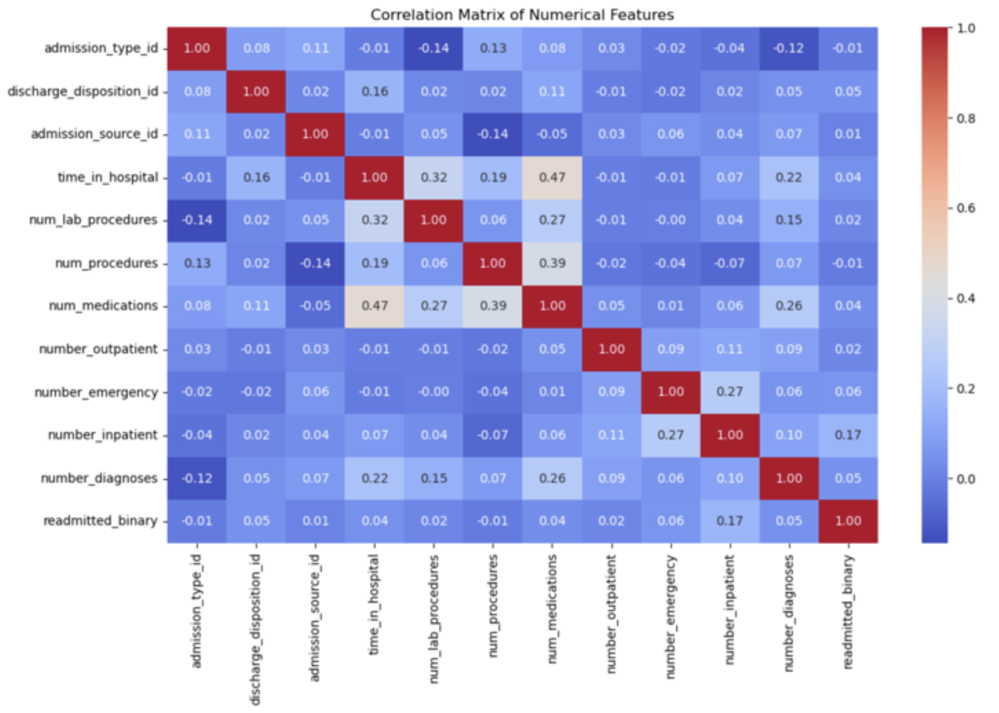
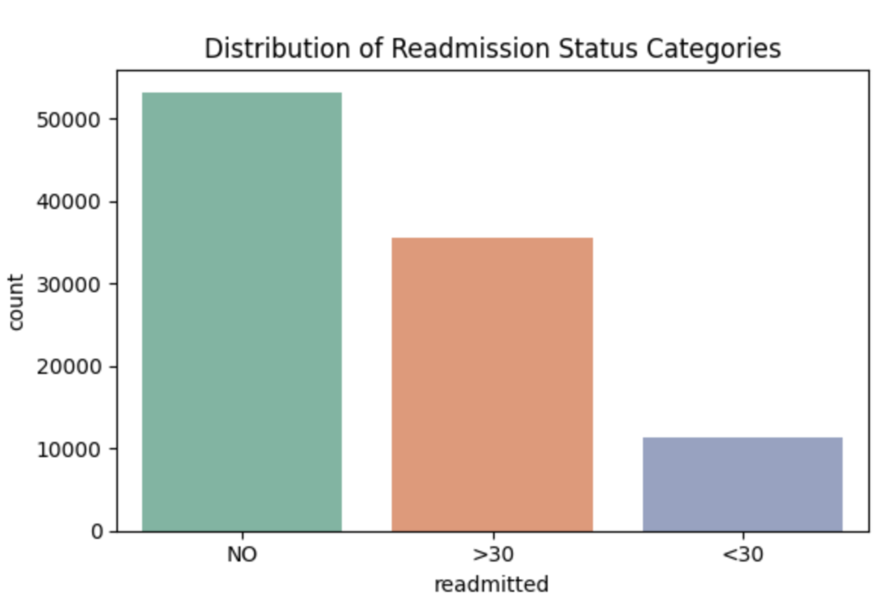
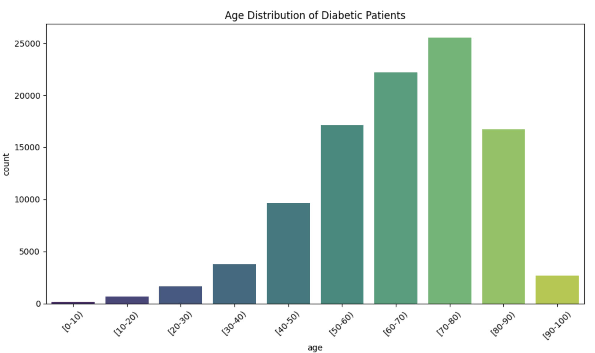
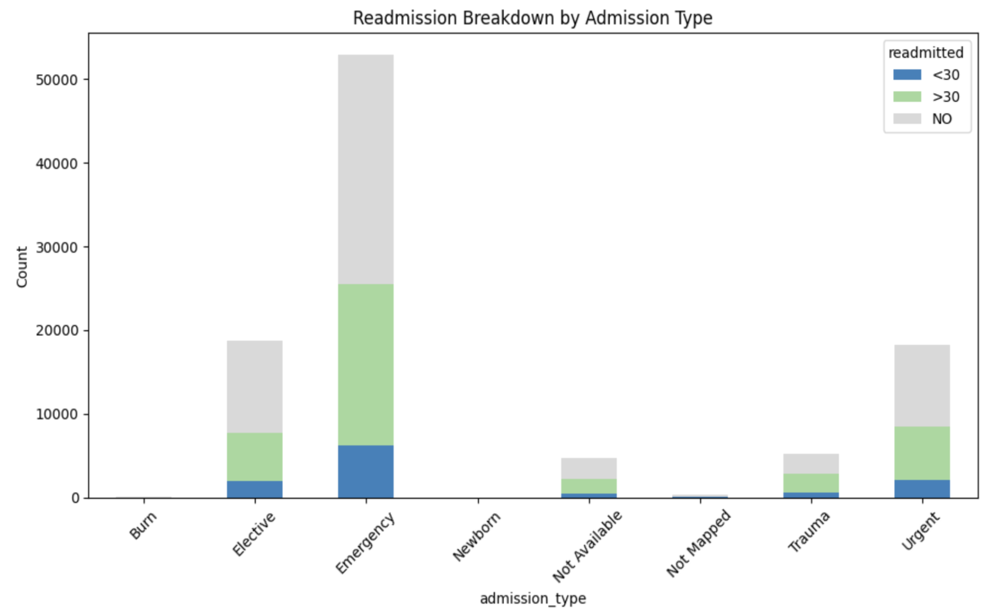
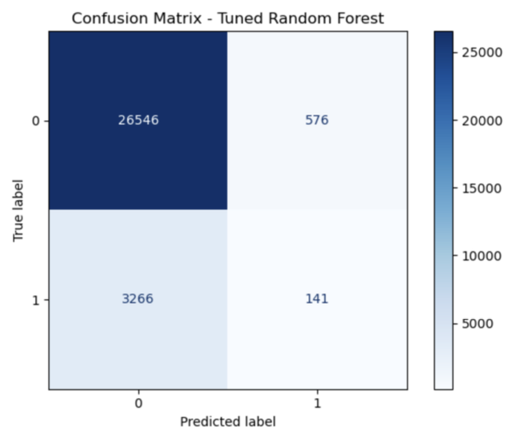
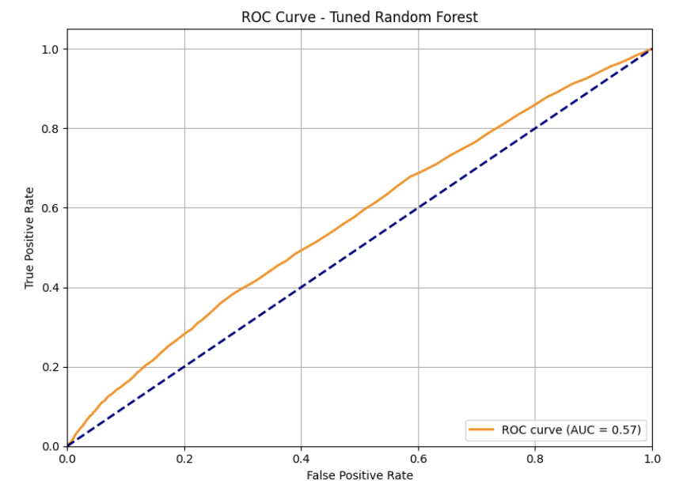
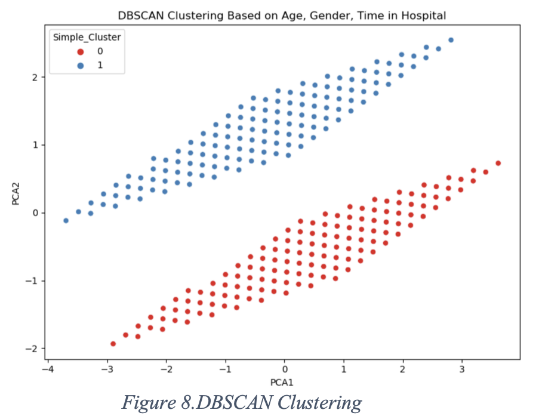

## Project Overview

Hospital readmissions are a significant healthcare challenge, contributing to rising medical costs and affecting patient outcomes. In this collaborative academic project at George Mason University, we analyzed diabetic patient data to explore factors associated with hospital readmissions, identify patient groups, and investigate medication patterns.

Our goal was to demonstrate how data analytics and machine learning can support a better understanding of readmission risk and healthcare utilization.

## Project Objectives

We investigated three main research questions:

1.  Can we predict whether a diabetic patient will be readmitted within 30 days of discharge?
2.  Can we identify patient groups based on healthcare utilization and treatment patterns?
3.  What combinations of patient characteristics and medication patterns are associated with readmission?

## Dataset

We used the **Diabetes 130-US Hospitals for Years 1999–2008** dataset from the UCI Machine Learning Repository.

-   **101,766** inpatient encounters
-   **130** U.S. hospitals
-   **10 years** of historical data
-   Demographic, diagnostic, medication, laboratory, and hospital utilization variables

The target variable represented three outcomes: readmission within 30 days, readmission after 30 days, and no readmission. For the classification task, early readmission was treated as the positive class.

## Data Cleaning and Preprocessing

The dataset required careful preparation before analysis.

-   Converted missing-value placeholders into proper missing values.
-   Removed variables with substantial missing data, including weight, payer code, and medical specialty.
-   Handled invalid demographic records and missing values.
-   Encoded categorical variables for machine learning.
-   Examined numerical relationships using correlation analysis.
-   Used feature importance to reduce the number of predictors.
-   Applied SMOTE to address class imbalance in the classification training data.

### Correlation Analysis

The correlation matrix helped us understand relationships among numerical features and identify potential predictors for further investigation.

{width="516"}

*Figure 1. Correlation matrix of numerical features.*

## Exploratory Data Analysis

EDA was a key part of my contribution. I examined the distribution of readmission outcomes, patient demographics, hospital utilization, and relationships among important variables.

### Distribution of Readmission Outcomes

The dataset contained substantially fewer early readmissions than non-readmissions, making class imbalance an important consideration for model development.

{width="481"}

*Figure 2. Distribution of no readmission, readmission after 30 days, and readmission within 30 days.*

### Age Distribution

We explored how hospital encounters were distributed across patient age groups. The dataset contained many encounters involving patients between 50 and 80 years of age.

{width="508"}

*Figure 3. Distribution of diabetic patient encounters across age groups.*

### Readmission by Admission Type

We compared readmission outcomes across admission types to investigate how patterns differed between emergency, elective, and other admission categories.

{width="496"}

*Figure 4. Readmission outcomes across admission types.*

These visualizations helped identify patterns that could inform subsequent modeling and healthcare analysis.

## Machine Learning and Analytical Methods

### 1. Random Forest Classification

We used a Random Forest classifier to investigate early readmission prediction. Since early readmissions represented a minority class, SMOTE was applied to help address the imbalance.

Important predictors identified during the analysis included:

-   Number of previous inpatient visits
-   Time spent in the hospital
-   Number of medications

#### Confusion Matrix

The confusion matrix illustrates the classification outcomes for the tuned Random Forest model, including correctly and incorrectly classified cases.

{width="389"}

*Figure 5. Confusion matrix for the Random Forest classification model.*

#### ROC Curve

The ROC curve evaluates how well the model distinguishes between early readmissions and other outcomes across different classification thresholds.

{width="465"}

*Figure 6. ROC curve. The reported AUC of approximately 0.57 indicates limited discrimination.*

The report contains differing accuracy figures in its abstract and results section. Therefore, these should be interpreted alongside the ROC result rather than presented as evidence of strong predictive performance.

### 2. DBSCAN Clustering

We used DBSCAN (Density-Based Spatial Clustering of Applications with Noise) to investigate patient groupings based on healthcare utilization and related characteristics.

The workflow included feature standardization and Principal Component Analysis (PCA) to reduce dimensionality and visualize the resulting clusters.

{width="425"}

*Figure 7. DBSCAN clustering visualization in PCA-reduced feature space.*

The visualization illustrated distinct groupings in the reduced feature space. These groups offered a starting point for exploring differences in healthcare utilization patterns.

### 3. Apriori Association Rule Mining

We applied the Apriori algorithm to identify recurring medication patterns associated with early readmission.

The analysis evaluated:

-   **Support:** How frequently a pattern occurred.
-   **Confidence:** How frequently the outcome occurred when a pattern was present.
-   **Lift:** How strongly the observed association differed from what would be expected under independence.

One reported rule involved an increase in insulin and the use of diabetes medication, with a lift of 1.6, confidence of 0.68, and support of 0.07.

These findings represent associations in the dataset, not evidence that medication changes cause readmissions.

## Key Findings

-   Previous inpatient visits, hospital length of stay, and medication counts were identified as important predictive features.
-   Early readmissions represented a minority of encounters, highlighting the importance of addressing class imbalance.
-   EDA revealed patterns across age groups, admission types, and readmission outcomes.
-   DBSCAN was used to explore patient groupings based on healthcare utilization.
-   Apriori association rules identified medication patterns associated with readmission.
-   The reported ROC AUC of approximately 0.57 highlighted the need for further model improvement.

## Technologies Used

**Programming and Analysis:** Python, Pandas, NumPy

**Machine Learning:** Scikit-learn, Random Forest, SMOTE, DBSCAN, PCA

**Association Rule Mining:** Apriori, mlxtend

**Visualization:** Matplotlib, Seaborn

## My Contribution

My primary responsibility was **Exploratory Data Analysis (EDA)**. I examined the dataset to identify key patterns, trends, distributions, and relationships relevant to hospital readmission. This analysis helped guide subsequent modeling and supported the interpretation of the results.

This was a collaborative academic project completed with Sai Praneet Reddy Chinthala, Bharath Vardhan Reddy Ravula, and Swapnaja Kulkarni at George Mason University.

## Conclusion

This project demonstrated how exploratory analysis, classification, clustering, and association rule mining can be combined to investigate diabetic patient readmissions.

Although the classification model showed limited discrimination according to the reported ROC AUC, the project provided useful insights into data quality, class imbalance, healthcare utilization patterns, and the challenges of predicting early readmissions.

The work strengthened my experience in healthcare analytics, data visualization, feature analysis, and machine learning workflows.

## References

1.  CDC, “National diabetes statistics report,” Centers for Disease Control and Prevention, 2024. https://www.cdc.gov/diabetes/php/data- research/index.html
2.  A. Singh, “Feature Engineering — A Machine Learning Approach to Predict Diabetic Patient Hospital Readmissions (contd..) — Part 9,” Medium, Jul. 06, 2019. https://medium.com/@akshay.43279/a- machine-learning-approach-to-predict-diabetic-patient-hospital- readmissions-contd-part-9-4f663f5bf15c (accessed May 12, 2025).
3.  M. Zeinalnezhad and S. Shishehchi, “An integrated data mining algorithms and meta-heuristic technique to predict the readmission risk of diabetic patients,” Healthcare Analytics, vol. 5, p. 100292, Jun. 2024, doi: https://doi.org/10.1016/j.health.2023.100292.
4.  Shiva, S. Reddy, N. Sethi, and R Rajender, “A COMPREHENSIVE ANALYSIS OF MACHINE LEARNING TECHNIQUES FOR INCESSANT PREDICTION OF DIABETES MELLITUS,” Jan. 01, 2020. https://www.researchgate.net/publication/343523593_A_COMPREH ENSIVE_ANALYSIS_OF_MACHINE_LEARNING_TECHNIQUE S_FOR_INCESSANT_PREDICTION_OF_DIABETES_MELLITUS
